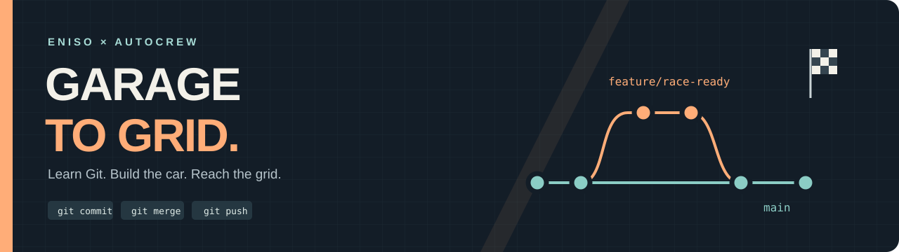
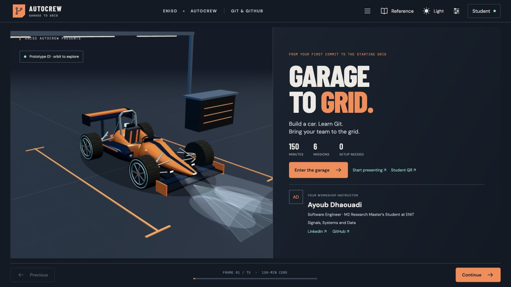
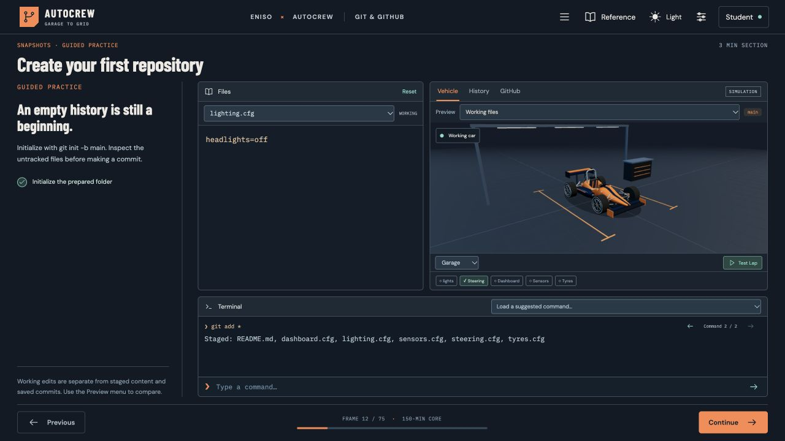

<div align="center">



# ENISO Autocrew · Garage to Grid

**Learn Git. Build the car. Reach the grid.**

A hands-on Git & GitHub workshop where every repair changes a 3D race prototype.

[](https://github.com/crunchy-tf/eniso-autocrew-garage-to-grid/actions/workflows/ci.yml)


[**Open the workshop**](https://autocrew-garage-to-grid-20261012.ayoubdhaouadi08.chatgpt.site) · [**Windows setup**](#run-on-windows) · [**Course map**](docs/course-map.md) · [**Answer sheets**](docs/answer-sheets.txt)

</div>

---

Built for the **ENISO Autocrew** automotive engineering and automotive software engineering club, taught by **Ayoub Dhaouadi**. This repository contains the complete workshop application so you can revisit the lessons, redo the missions, and explore the code on your own laptop.



## From garage to grid

You receive a prototype with broken steering. By the end, you have a reviewed, integrated car ready for a wet test track.

| Mission | Your challenge | Git skills |
| :--- | :--- | :--- |
| **01 · Investigate** | Find yesterday's working steering setting | `clone`, `status`, `remote`, `log`, `show` |
| **02 · Repair** | Recover calibrated steering and switch on the lights | Branching, recovery, staging, commits |
| **03 · Develop** | Build the cockpit on a separate feature branch | `switch` / `checkout`, feature commits, merge |
| **04 · Collaborate** | Integrate the pit crew's sensor upgrade | Fetch, remote-tracking references, integration |
| **05 · Resolve** | Decide between wet tyres and slicks | Conflicts, requirements, staging a resolution |
| **06 · Ship** | Share, review, merge, and synchronize | Push, upstream, pull requests, review, pull |

The workshop includes **75 presentation frames**, **11 quiz questions**, short practical exercises, and the six connected missions. The core takes about **150 minutes**; an optional real Git/GitHub lab adds **30 minutes**. You can revisit it at your own pace.

## Run on Windows

**Start here if you attended the workshop on a Windows laptop.** No Mac, Docker, WSL, SSH keys, GitHub login, API keys, or `.env` file are needed to clone this public project and replay the core workshop.

### 1. Install the prerequisites once

1. Install **Node.js 24 LTS** from [nodejs.org](https://nodejs.org/en/download). Select version **24**, Windows, and the **Windows Installer (.msi)**. npm is included. Choose **x64** for an Intel/AMD laptop, or **ARM64** for a Windows-on-ARM laptop. Windows **Settings → System → About → System type** identifies your architecture.
2. Install [Git for Windows](https://gitforwindows.org/). During setup, ensure Git is available **from the command line and third-party software**.
3. Close and reopen PowerShell or Windows Terminal so it picks up the updated `PATH`.

Open **PowerShell** and check:

```powershell
node --version
npm.cmd --version
git --version
```

You should see Node **v24.x**, npm **11.x**, and a Git version. These commands should print versions before you continue.

> We use `npm.cmd` in the Windows instructions so PowerShell does not try to run `npm.ps1`. If your school laptop blocks PowerShell scripts, you can still run npm this way without changing your execution policy. The same commands also work in Command Prompt.

### 2. Clone and install

In PowerShell, move to a folder where you keep projects. The following creates the project in your current folder:

```powershell
git clone https://github.com/crunchy-tf/eniso-autocrew-garage-to-grid.git
cd eniso-autocrew-garage-to-grid
npm.cmd ci
```

The first install needs internet access. Keep `package-lock.json`: it makes the dependency installation reproducible. npm installs the native dependencies for **your Windows architecture**; the developer's Mac dependencies are not included.

**Prefer a ZIP?** Select **Code → Download ZIP** on GitHub, extract it fully, open PowerShell in the extracted folder containing `package.json`, and run `npm.cmd ci`. You can launch the core workshop from a ZIP without Git, but the real-Git comparison tests and optional real lab need Git installed.

### 3. Start the website

```powershell
npm.cmd run dev
```

Open the **Local** URL printed in the terminal, normally:

**http://127.0.0.1:5173/**

Keep that terminal open while using the workshop. If 5173 is already occupied, Vite may print another port; use the URL it actually prints. Stop the server with **Ctrl+C**.

### 4. Revisit or restart

- Follow **Previous / Continue**, or open **Workshop chapters** to jump to a topic.
- Enter workshop commands in the website's **Terminal** panel.
- Use **Settings → Reset progress** to restart the whole workshop; this discards your saved local workshop attempt.
- Use the workbench's **Reset** button to restart a single drill. On a main mission, Reset restarts the connected mission exercise.
- Refreshing keeps progress. **Settings → Export progress / Import progress** lets you move an attempt between browsers or devices.
- For presenter notes, open the same local URL with `?mode=presenter#/welcome`, for example `http://127.0.0.1:5173/?mode=presenter#/welcome`.

### 5. Start it again another day

Open PowerShell in the same project folder:

```powershell
npm.cmd run dev
```

You do not need to reinstall dependencies each time. To get a newer repository version from a clean checkout:

```powershell
git pull --ff-only
npm.cmd ci
npm.cmd run dev
```

If you have made your own source changes, commit or otherwise preserve them before pulling an update.

## Run on macOS or Linux

Use **Node.js 24**, **npm 11**, and Git. On Apple Silicon, install the native ARM64 Node distribution. If you already use nvm, this repo includes `.nvmrc`, so `nvm install` followed by `nvm use` selects Node 24.

```bash
git clone https://github.com/crunchy-tf/eniso-autocrew-garage-to-grid.git
cd eniso-autocrew-garage-to-grid
npm ci
npm run dev
```

Open the Local URL printed by Vite. Stop with **Ctrl+C**. The same source supports Windows and macOS; each computer installs its own dependencies.

## Two terminals, two purposes

| Terminal | What belongs there |
| :--- | :--- |
| **PowerShell / your computer's terminal** | Clone this repository, install dependencies, start the app, edit its source, and run the optional real Git lab. |
| **Terminal inside the website** | Solve the guided exercises and six missions in an independent virtual repository. These commands change the simulated car and its history. |

The core sandbox has **no student accounts and no real GitHub connection**. Its `workshop-demo` repository URL is illustrative and works inside the website. Hosting the website on localhost does not turn that illustrative URL into a real repository.

The optional real lab uses the [starter project](public/starter-project.zip), your real terminal, and your own GitHub repository. It is separate from this application's source repository.

## A workbench you can actually explore



- **Visual feedback:** headlights, steering, dashboard, obstacle detection, and tyre choice change the car's configuration and test results.
- **Compare snapshots:** preview working files, the index, saved commits, local branches, and remote versions.
- **Choose a valid workflow:** `git add *`, `git add -A`, `git commit -am`, `checkout`, and equivalent recovery/integration routes are accepted where appropriate. Mission checks examine repository outcomes and integrated history.
- **Work in the terminal or editor:** virtual `echo`, `printf`, `touch`, `rm`, redirections, `&&`, and `;` support common file workflows.
- **Presentation controls:** fixed frames, dark/light modes, presenter notes, and explicit pagination for longer files and output.
- **Lower-powered laptops:** Settings provides low/medium/high graphics, **diagram mode**, and reduced motion. Lesson content remains available without the 3D view.

### Sandbox boundaries

The app models snapshots, immutable commits, branch pointers, a staging area, three-way merges, conflicts, remote tracking, push/pull, and reviewed pull requests. IDs such as `a000001` are teaching identifiers.

It is not a full Git binary or operating-system shell. Stash, rebase, amend, history reset, tags, blame, bisect, reflog, force push, general system programs, and pipes are outside the implemented subset. Path-based reset for unstaging is supported. The GitHub pane performs a simulated review.

## Course materials

| Resource | What's inside |
| :--- | :--- |
| [Every frame, in order](docs/course-map.md) | Complete presentation progression |
| [Student reference](docs/student-reference.md) | Git concepts, commands, and alternative workflows |
| [Complete answer sheets](docs/answer-sheets.txt) | All 11 quiz answers, practical solutions, six missions, alternatives, optional real lab, and troubleshooting |
| [Instructor guide](docs/instructor-guide.md) | Pacing, presentation controls, facilitation, and session adaptations |
| [Starter project](public/starter-project.zip) | Small automotive configuration project for the real Git lab |

Try a mission before opening its answers. The answers deliberately include multiple approaches so you can compare the resulting history and staging behavior.

## Check or build the project

The real-Git comparison tests require `git` on your `PATH`.

**PowerShell / Windows:**

```powershell
npm.cmd run typecheck
npm.cmd test
npm.cmd run build
npm.cmd run preview
```

**macOS / Linux:**

```bash
npm run typecheck
npm test
npm run build
npm run preview
```

The test suite contains **40 tests**, including six comparisons against real Git and an alternative solution through all six missions. GitHub Actions runs installation, type checking, tests, and production builds on **Windows, macOS, and Linux**.

`build` creates `dist/`. `preview` serves that build locally, normally at **http://127.0.0.1:4173/**; follow the printed URL if the port differs. Opening `index.html` directly with `file://` is not supported.

For static hosting, deploy **the contents of `dist/`** to a host serving HTTP/HTTPS. Relative assets and hash routes support subdirectory hosting without route rewrites. No backend or environment secrets are needed. The built lesson assets are bundled locally; external profile links and the Join QR lead to online resources.

## Troubleshooting on Windows

| Symptom | What to do |
| :--- | :--- |
| `node`, `npm.cmd`, or `git` is not recognized | Install the corresponding prerequisite, reopen the terminal, and recheck its version. |
| `npm.ps1 cannot be loaded` / scripts are disabled | Use **`npm.cmd`** instead of `npm`; no execution-policy change is needed. |
| `ENOENT` or missing `package.json` | You are in the wrong folder. Run `Get-Location` and `Get-ChildItem`; enter the extracted/cloned project root. |
| Unsupported Node/npm version | Install Node **24** with its bundled npm **11**, reopen the terminal, and reinstall with `npm.cmd ci`. |
| Native binding missing after copying from a Mac | Stop the server and run `npm.cmd ci` in the Windows checkout. It recreates `node_modules` from the lockfile for your platform. |
| Install/network error | Check internet/proxy access and retry `npm.cmd ci`. Keep the lockfile rather than regenerating it as a workaround. |
| The browser cannot reach localhost | Keep the dev server running and open its printed Local URL. |
| The 3D view is slow or unavailable | Select **Settings → 3D quality → low** or **diagram**; optionally enable reduced motion. |
| Real-Git tests cannot launch `git` | Install Git for Windows and reopen the terminal. The core browser exercises do not execute your system Git. |
| The mission remains incomplete | Compare Working / Index / HEAD; commit the intended repair and integrate the required branch history. Check the answer sheet after trying a hint. |

Progress is stored per browser and **origin**. The online website, `127.0.0.1`, `localhost`, and different ports have separate progress. Export/import bridges them.

## Under the hood

```text
src/
├── App.tsx               Course navigation, themes, presenter tools
├── frames.ts             75 presentation frames and routes
├── screens.json          Topic content and teaching progression
├── content.ts            Commands, quizzes, missions, source references
├── repo.ts               Repository state, commit DAG, merges and mission goals
├── shell.ts              Virtual shell parsing, quoting and wildcard expansion
├── WorkspaceView.tsx     File editor, terminal, snapshots and GitHub panel
├── Scene.tsx             Live 3D garage, cameras and test lap
├── vehicleModel.ts       Original procedural race prototype
├── persistence.ts        Local progress and validated imports
└── *.test.ts             Repository, shell, persistence and frame tests
public/                   Fonts, licenses, starter project and command reference
docs/                     Course materials and screenshots
.github/workflows/ci.yml  Cross-platform checks
```

**React + TypeScript** drive the interface. **Vite** builds and serves it. **Three.js** renders the original car and garage. Each student's workspace is independent; instructor frame cues provide pacing rather than a classroom synchronization server.

Want to improve it? Start with [CONTRIBUTING.md](CONTRIBUTING.md), keep a focused branch, and run the checks above.

## Created for ENISO Autocrew

**Ayoub Dhaouadi** — Software Engineer; M2 Research Master's Student at **ENIT**, Signals, Systems and Data.

[LinkedIn](https://www.linkedin.com/in/ayoub-dhaouadi-eng/) · [GitHub](https://github.com/crunchy-tf)

Curriculum references: [MIT Missing Semester — Version Control](https://missing.csail.mit.edu/2026/version-control/), [Pro Git](https://git-scm.com/book/en/v2), [Git reference](https://git-scm.com/docs), and [GitHub Flow](https://docs.github.com/en/get-started/using-github/github-flow).

The automotive scene and model were created for this workshop. Bundled Barlow Condensed, DM Sans, and IBM Plex Mono fonts include their SIL Open Font License notices under `public/fonts/`. Dependency notices are preserved in [THIRD_PARTY_NOTICES.txt](public/THIRD_PARTY_NOTICES.txt).

<div align="center">

**A clean commit. A clear review. A car ready for the grid.**

</div>
